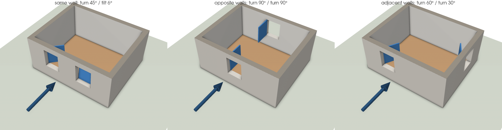
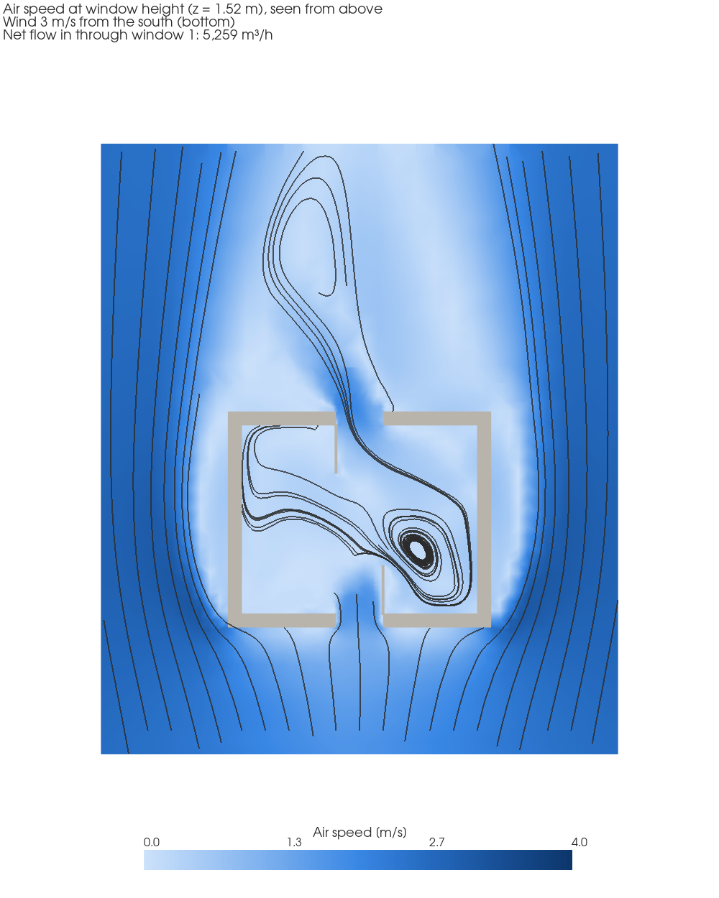
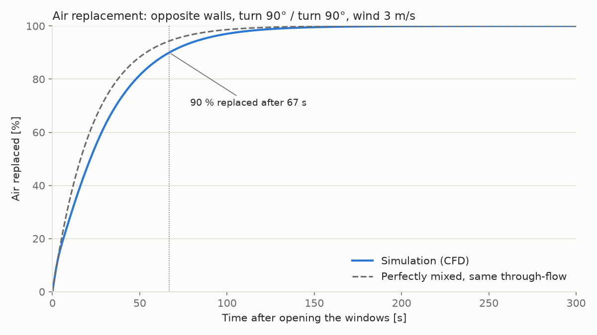
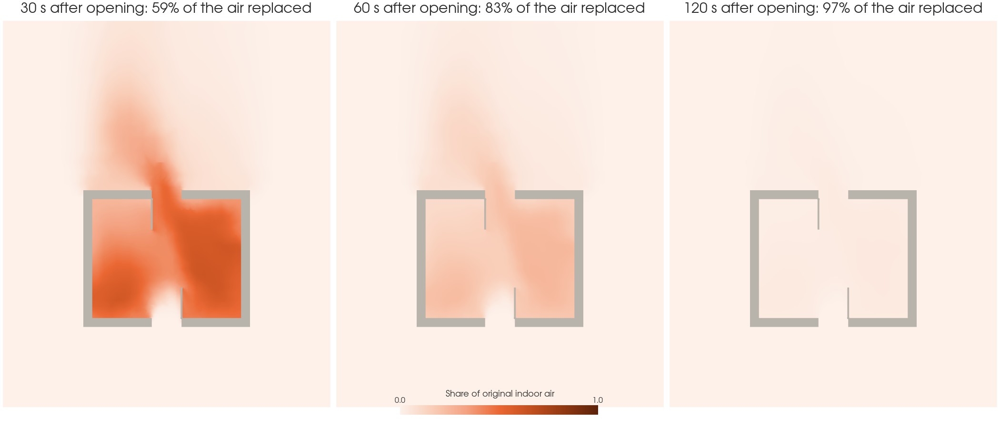
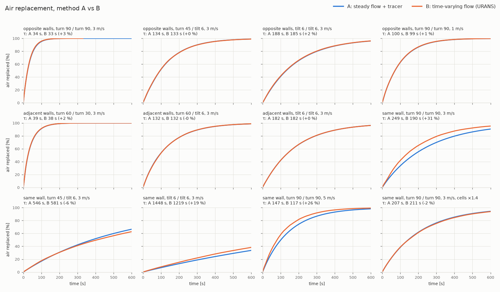

# Stoßlüften CFD

This project runs automated **OpenFOAM** simulations of *Stoßlüften*: opening windows wide for a few minutes to replace the air in a room. The room has two windows, and the results become a dataset for training a **machine learning surrogate model**. It is a student project for the Master's course *Machine Learning* at Hochschule Hannover.



*The three window layouts, shown with the roof removed. The blue plates are the open sashes, and the arrow shows the wind coming from the south. These are the example cases in `configs/examples/`.*

## Status

| Step | State |
|---|---|
| Project plan | ✅ [PLAN.md](PLAN.md) |
| Geometry and mesh generator | ✅ |
| OpenFOAM case: steady wind flow | ✅ first test case runs |
| Tracer (air replacement) and metrics | ✅ runs on the frozen steady flow |
| Solver benchmark: comparison with a fully transient run | ✅ decided: fast method for windows on different walls, exact method for the same wall (see below) |
| Mesh study | ✅ snappyHexMesh, medium cell sizes (see PLAN.md §6) |
| Parameter sweep, dataset | 🟡 inputs drawn: 150 training + 30 test cases (`configs/sweep/`); pilot next |

## First result



This is the default case: windows on opposite walls, both turned open 90°, with a 3 m/s wind from the south. The wind enters through the south window and crosses the room diagonally as a jet, with a slow vortex in the south-east corner. It leaves through the north window. About **5,250 m³/h** of air flows through the 50 m³ room.

The mesh is a hex-dominant snappyHexMesh with 103k cells, and the whole case (mesh, flow, tracer) takes about 5 min on 8 cores. The mesh study in [PLAN.md §6](PLAN.md) shows that the air-replacement results change by less than 2 % with finer cells.

### Air replacement



**How the tracer works.** Imagine the room air were coloured with ink.
1. **Start:** all air inside the room is coloured (value 1 = 100 % old air). The outdoor air is clear (value 0 = fresh air).
2. **Opening the windows:** the simulated wind carries the coloured air out of the windows and brings clear air in. Swirls in the air also mix the two, like stirring milk into coffee.
3. **Every 0.2 s** the computer moves the colour a little further with the airflow, for 10 minutes in total.
4. **Measuring:** at each step we take the average colour of the whole room. If it is 0.3, then 30 % of the air is still old air, so 70 % has been replaced. That gives the curve above.

The colour is only a marker. It does not push the air around, so the wind can be computed first and the colour moved through it afterwards (the fast method A). For windows on the same wall, the airflow keeps changing over time, so wind and colour are computed together (method B, see below).

- **90 % replaced:** after **76 s**.
- **Time constant:** the curve follows 1 − exp(−t/τ) with **τ = 33.5 s**.
- **Compared with perfect mixing:** a perfectly mixed room with the same airflow would reach 90 % after about 79 s. The diagonal jet stirs the whole room, so it comes close to perfect mixing.



The pictures show where the old air stays longest: in the eastern half of the room, around the vortex, and in the south-west corner.

### Solver benchmark: is the fast method good enough?

The dataset uses a fast method:
- **(A)** compute the steady (averaged) wind flow once, then move the tracer through it.

We compared it with a much more expensive one:
- **(B)** compute the time-varying flow with the tracer (URANS), about 25–30× slower.

We ran both methods on 12 cases: every window layout, turned and tilted windows, wind at 1, 3 and 5 m/s, and one case on a coarser mesh.



- **Windows on different walls:** the two methods agree within 3 % in all 7 cases. The fast method is good enough here.
- **Both windows on the same wall:** they differ by −6 % to +31 %. In the time-varying flow, air swings in and out of the windows, and the steady flow cannot represent that. These results also depend more on the mesh.
- **Wind speed:** the results scale exactly with wind speed. At 1 m/s, the air is replaced 3× slower than at 3 m/s.
- **Cost:** method B takes about 40 min per case, method A about 5 min.

**Decision:** the dataset uses method A for windows on different walls and method B for windows on the same wall. The sweep then takes about 2 days of compute. `cfd.run_case` picks the method automatically. Details are in [PLAN.md §5](PLAN.md).

## What is simulated

- **Room:** 5 × 4 × 2.5 m with two Dreh-Kipp windows.
- **Window layouts:** both windows on the same wall, on opposite walls, or on adjacent walls.
- **Window opening:** each window is either turned open (angle 15–90°, hinged on the left or right) or tilted (6°).
- **Wind:** comes from the south at 1–5 m/s and blows around the building.
- **Tracer:** the room starts full of "old air" (a tracer value of 1). We measure how fast fresh outdoor air replaces it.
- **Output:** each simulation adds one row to `results/summary.csv`, containing the inputs and results such as the fresh-air fraction over time and the time until 90 % of the air is replaced.

Details are in [PLAN.md](PLAN.md).

## Setup

You only need this on the **Linux machine that runs the simulations**. Teammates who only work with the results (CSV files) don't need to install anything here.

For the Windows PC that will run the big sweep (WSL2 with Ubuntu), follow [hpc/setup/README.md](hpc/setup/README.md) instead.

1. Install OpenFOAM v2606 and ParaView. On Arch Linux, run `yay -S openfoam-com paraview`.
   - **Known build problem (Oct 2026):** the build stops at `viewFactorsGen` with `undefined reference to __gmpz_…`, and the solvers are never built. To fix it:
     1. In `~/.cache/yay/openfoam-com/src/OpenFOAM-v2606/applications/utilities/preProcessing/viewFactorsGen/Make/options`, add the line `$(CGAL_LIBRARIES) \` as the first entry under `EXE_LIBS = \`.
     2. In `~/.cache/yay/openfoam-com`, run `makepkg -e` to finish the build without unpacking the sources again.
     3. If packaging then fails with "File exists" errors, run `rm -rf pkg && makepkg -R` to redo only the packaging.
     4. Install with `sudo pacman -U openfoam-com-v2606-1-x86_64.pkg.tar.zst`.
2. Create the Python environment in the repository folder:

   ```bash
   python3 -m venv .venv
   .venv/bin/pip install -r requirements.txt
   ```

3. In every new terminal, activate the environment and load OpenFOAM:

   ```bash
   source .venv/bin/activate
   of    # if "of" is not found: source /opt/OpenFOAM/OpenFOAM-v2606/etc/bashrc
   ```

## Usage

```bash
python -m geometry.generate --config configs/default.yaml                     # build + mesh -> cases/default/mesh.msh
python -m geometry.render configs/default.yaml --out docs/images/default.png  # picture of the room setup
python -m cfd.run_case --config configs/default.yaml                          # wind + air replacement (needs OpenFOAM, ~4 min)
python -m cfd.run_case --config configs/demo/demo_2.yaml --steady-only        # same-wall case without the slow method B (quick test)
python -m cfd.run_case --config configs/default.yaml --tracer-only            # rerun only the air replacement
python -m analysis.visualize --config configs/default.yaml --kind flow --out flow.png   # also: --kind tracer, curve, mesh
python -m analysis.compare_methods configs/comparison/*.yaml --out comparison.png      # method A vs B table and curves
python -m analysis.monitor                                                    # live window: progress, CPU cores, convergence
python -m pytest                                                              # run all tests
```

**Monitor:** `python -m analysis.monitor` opens a dark window on the right half of the screen. It refreshes every 5 s and shows:
- every running case, with progress, estimated finish time and two small plots that show whether the values level off;
- the load of every CPU core and which case runs on it;
- the run queues: counts, progress, average time per case, and the expected finish time, even for hundreds of entries.

The queue list fills the rest of the window height and scrolls with the mouse wheel. The window can be resized up to full screen; the layout adapts. Closing it does not affect the simulations. Options: `--interval 10`, `--geometry 960x1040+960+0`, `--once picture.png`.

**Run queue:** many cases one after another, for example a parameter sweep. Start runs this way, even single ones, so that they show up in the monitor's queue list:

```bash
setsid nohup python -m cfd.queue configs/examples/*.yaml > cases/queue.out 2>&1 &
setsid nohup python -m cfd.queue --transient --procs 4 configs/benchmark/snappy_medium.yaml > cases/queue_b.out 2>&1 &   # comparison runs
setsid nohup python -m cfd.queue --resume cases/queues/<name>.json > cases/queue.out 2>&1 &   # after an interruption
```

**Long runs:** a simulation started from a terminal or from VS Code stops when that window is closed. To keep it running, start it detached, with the log going to a file:

```bash
setsid nohup python -m cfd.run_case --config configs/default.yaml > run.out 2>&1 &
```

An interrupted transient comparison run can be continued from its last save point (every 30 s of simulated time) with `--transient --resume`.

`cfd.run_case` writes everything to `cases/<case_id>/`:
- `summary.json`: the key numbers.
- `fresh_fraction.csv`: the air-replacement curve, one value per second.
- For same-wall cases also `transient/` and `fresh_fraction_transient.csv` (method B, about 40–120 min). `summary.json` says which method counts for the dataset (`"method"`).
- A `log.<tool>` file for each OpenFOAM tool's output.

The first run automatically compiles our own OpenFOAM solver `tracerFoam` (`cfd/solvers/`).

To try a different case:

1. Copy `configs/default.yaml` or one of the files in `configs/examples/`.
2. Change the values (layout, window positions, modes, angles, hinge sides, wind speed).
3. Pass the new file to the commands above.

Invalid values stop with a message that says what to fix. `geometry.render` takes several config files at once and puts their pictures side by side.

## Repository layout

| Path | Contents |
|---|---|
| `configs/` | Case files (YAML): one example per layout in `configs/examples/`, the mesh and solver checks in `configs/benchmark/` and `configs/comparison/` |
| `cfd/` | Config loading, the OpenFOAM case templates and setup, the case runner, and our tracer solver |
| `analysis/` | Metrics and pictures from solved cases |
| `geometry/` | Window placement, the Gmsh geometry and mesh generator, and the 3D renders |
| `docs/images/` | Pictures used in this README |
| `docs/overview/` | One-page project overview (LaTeX and PDF) |
| `docs/demo/` | Pictures of two randomly drawn demo cases (`configs/demo/`): setup, streamlines, mesh |
| `tests/` | Automated tests |
| `hpc/` | Remote sweep runner ([HPC_PLAN.md](HPC_PLAN.md)); `hpc/setup/` sets up the simulation PC |
| `cases/` | Generated simulation folders (not in git) |
| `results/` | The dataset (planned) |

## Documentation

- [docs/overview/overview.pdf](docs/overview/overview.pdf): one-page overview of the project for readers without CFD background (source: `overview.tex`, build with `latexmk -pdf`).
- [PLAN.md](PLAN.md): agreed decisions, dataset columns and schedule.
- [HPC_PLAN.md](HPC_PLAN.md): plan for running the sweep on a remote Windows/WSL2 PC, controlled through GitHub, with a status dashboard.
- [DATASET_PLAN.md](DATASET_PLAN.md): plan for the sweep generator (random input combinations) and the dataset writer (the CSV).
- [VENTILATION_CFD_PROJECT.md](VENTILATION_CFD_PROJECT.md): the original project specification.
- [log.md](log.md): how AI tools were used in each step (a course requirement).
- [AGENTS.md](AGENTS.md): instructions for AI coding assistants working in this repository.
