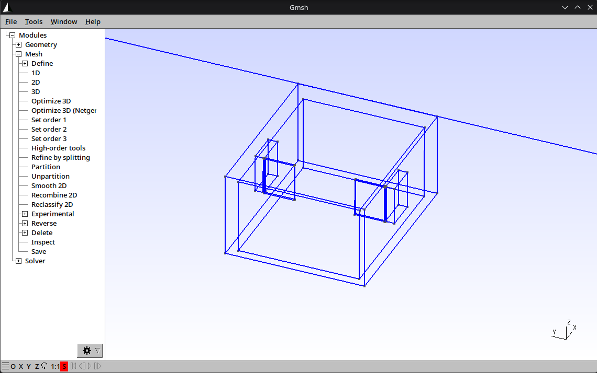

# Stoßlüften CFD

This project runs automated **OpenFOAM** simulations of *Stoßlüften*: opening windows wide for a few minutes to replace the air in a room. The room has two windows, and the results become a dataset for training a **machine learning surrogate model**. It is a student project for the Master's course *Machine Learning* at Hochschule Hannover.



*Default case in Gmsh: the room inside its 0.3 m walls, with one window on the south wall and one on the north wall.*

## Status

| Step | State |
|---|---|
| Project plan | ✅ [PLAN.md](PLAN.md) |
| Geometry and mesh generator | ✅ |
| OpenFOAM case (steady wind flow, tracer) | ⏳ next |
| Solver benchmark, parameter sweep, dataset | planned |

## What is simulated

- **Room:** 5 × 4 × 2.5 m with two Dreh-Kipp windows.
- **Window layouts:** both windows on the same wall, on opposite walls, or on adjacent walls.
- **Window opening:** each window is either turned open (angle 15–90°) or tilted (6°).
- **Wind:** comes from the south at 1–5 m/s and blows around the building.
- **Tracer:** the room starts full of "old air" (a tracer value of 1). We measure how fast fresh outdoor air replaces it.
- **Output:** each simulation adds one row to `results/summary.csv`, containing the inputs and results such as the fresh-air fraction over time and the time until 90 % of the air is replaced.

Details are in [PLAN.md](PLAN.md).

## Setup

You only need this on the **Linux machine that runs the simulations**. Teammates who only work with the results (CSV files) don't need to install anything here.

1. Install OpenFOAM v2606 and ParaView. On Arch Linux, run `yay -S openfoam-com paraview`.
2. Create the Python environment in the repository folder:

   ```bash
   python3 -m venv .venv
   .venv/bin/pip install -r requirements.txt
   ```

3. In every new terminal, activate the environment and load OpenFOAM:

   ```bash
   source .venv/bin/activate
   of
   ```

## Usage

```bash
python -m geometry.generate --config configs/default.yaml                     # build + mesh -> cases/default/mesh.msh
python -m geometry.generate --config configs/default.yaml --no-mesh --gui     # look at the geometry
python -m pytest                                                              # run all tests
```

To try a different case, copy `configs/default.yaml`, change the values (layout, window positions, modes, angles, wind speed) and pass the new file with `--config`. Invalid values stop with a message that says what to fix.

## Repository layout

| Path | Contents |
|---|---|
| `configs/` | Case files (YAML) |
| `cfd/` | Config loading; later the OpenFOAM case setup and runner |
| `geometry/` | Window placement and the Gmsh geometry and mesh generator |
| `tests/` | Automated tests |
| `cases/` | Generated simulation folders (not in git) |
| `results/` | The dataset (planned) |

## Documentation

- [PLAN.md](PLAN.md): agreed decisions, dataset columns and schedule.
- [VENTILATION_CFD_PROJECT.md](VENTILATION_CFD_PROJECT.md): the original project specification.
- [log.md](log.md): how AI tools were used in each step (a course requirement).
- [AGENTS.md](AGENTS.md): instructions for AI coding assistants working in this repository.
